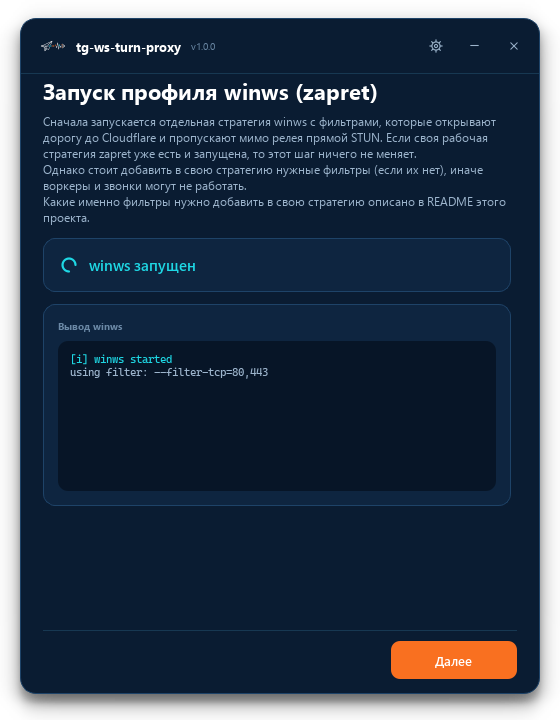
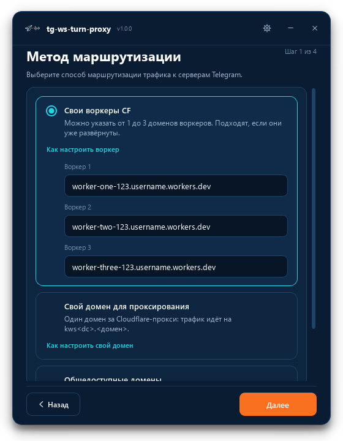
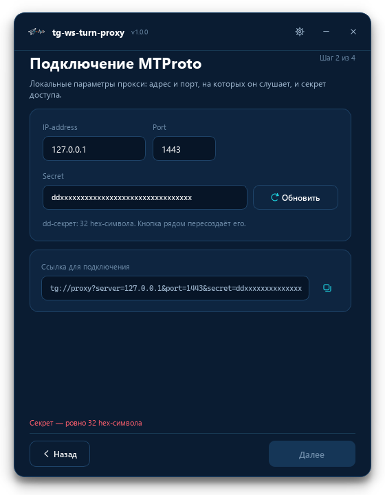
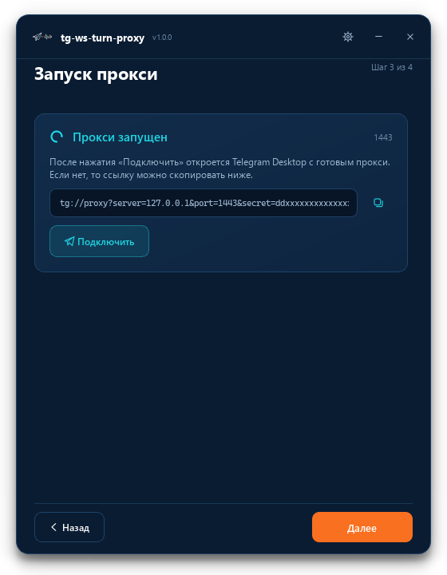
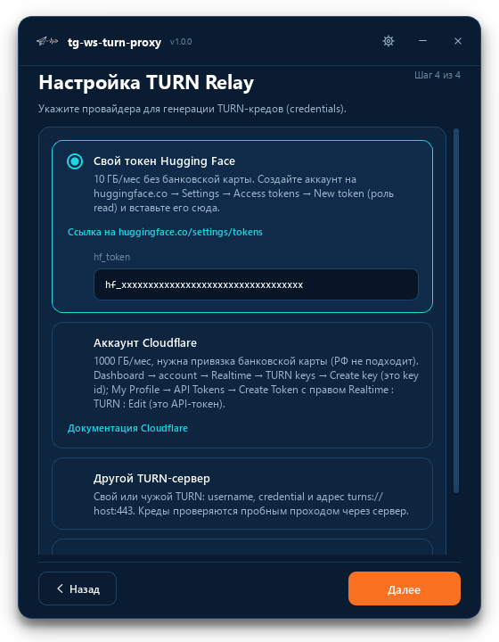
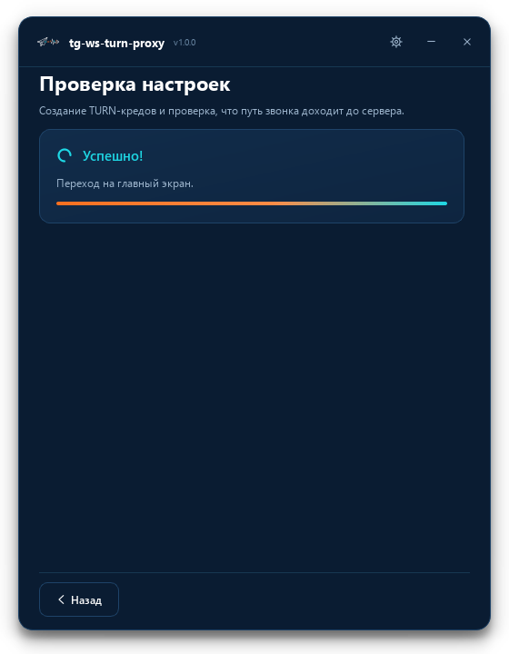
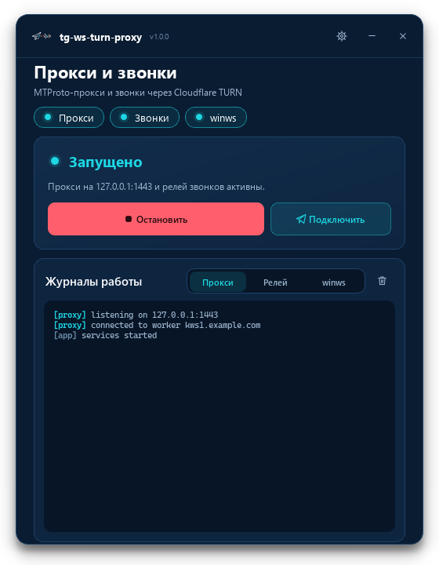
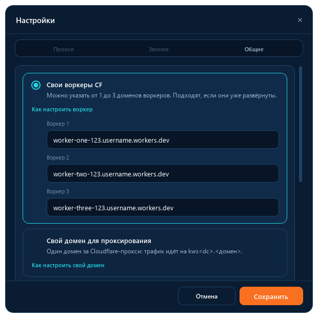
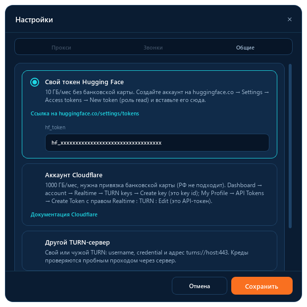
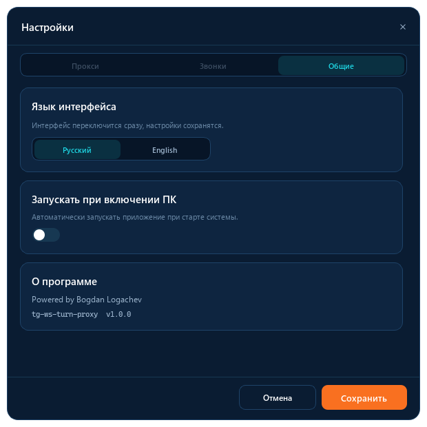

# tg-ws-turn-proxy

**Локальный MTProto-прокси для Telegram Desktop и релей звонков через TURN в одном приложении для Windows.**

Версия 1.0.0 · Windows 10/11 x64 · Python 3.9+ (для сборки из исходников)

---

`tg-ws-turn-proxy` — простое и удобное приложение, которое поднимает на вашем компьютере локальный MTProto-прокси для Telegram Desktop и, при необходимости, направляет трафик звонков через TURN-сервер. Всё работает локально: приложение не требует регистрации, не собирает статистику и не использует собственные сервера. Из внешнего используются только те, которые вы выбрали сами, — домены Cloudflare, через которые приложение соединяется с дата-центрами Telegram, и TURN-провайдер для звонков.

Инструмент рассчитан на ситуацию, когда IP-адреса Telegram из вашей сети недоступны или соединение с ними нестабильно. В этом случае приложение устанавливает подключение к серверам Telegram через обычный HTTPS/WebSocket-канал, а звонки — через TURN поверх TLS.

---

## Содержание

- [Быстрый старт](#быстрый-старт)
- [Возможности](#возможности)
- [Как это работает](#как-это-работает)
- [Состав проекта](#состав-проекта)
- [Что изменено по сравнению с оригинальными проектами](#что-изменено-по-сравнению-с-оригинальными-проектами)
- [Установка готовой сборки](#установка-готовой-сборки)
- [Первый запуск](#первый-запуск)
- [Подключение Telegram Desktop](#подключение-telegram-desktop)
- [Главный экран и трей](#главный-экран-и-трей)
- [Настройки](#настройки)
- [Звонки](#звонки)
- [Совместимость с собственной стратегией zapret](#совместимость-с-собственной-стратегией-zapret)
- [Файлы, пути и журналы](#файлы-пути-и-журналы)
- [Сборка из исходников](#сборка-из-исходников)
- [Диагностика из командной строки](#диагностика-из-командной-строки)
- [Частые вопросы](#частые-вопросы)
- [Безопасность и конфиденциальность](#безопасность-и-конфиденциальность)
- [Лицензии и благодарности](#лицензии-и-благодарности)

---

## Быстрый старт

1. Установите приложение или распакуйте portable-сборку и запустите её.
2. Пройдите мастер настройки: выберите способ маршрутизации, укажите адрес, порт, секрет и TURN-провайдера для звонков.
3. После мастера службы уже запущены. Если они остановлены, нажмите **«Запустить»**, затем **«Подключить»** — Telegram Desktop получит настройки прокси.
4. Закройте окно — приложение свернётся в трей и продолжит работать.

Подробное описание каждого шага — в разделах ниже.

---

## Возможности

- **MTProto-прокси** на `127.0.0.1:1443` (адрес и порт настраиваются) с `dd`-секретом из 32 hex-символов.
- **Подключение в один клик**: кнопка формирует ссылку `tg://proxy` и передаёт её Telegram Desktop.
- **Три способа маршрутизации** трафика к серверам Telegram:
  - свои воркеры Cloudflare (1–3 домена);
  - собственный домен за Cloudflare-прокси;
  - общедоступный список доменов из проекта `Flowseal/tg-ws-proxy`.
- **Звонки через TURN** с выбором провайдера: свой токен Hugging Face, ключи Cloudflare Realtime TURN, произвольный TURN-сервер или общий токен.
- **Проверка перед запуском**: приложение получает TURN-креды и пробным запросом убеждается, что путь до сервера рабочий.
- **Автоматический профиль winws** (zapret): перед стартом поднимается отдельная стратегия с нужными фильтрами, чтобы соединения с Cloudflare устанавливались стабильно. Если `winws` уже запущен, второй экземпляр не создаётся.
- **Понятный интерфейс**: мастер настройки, статусы «Прокси / Звонки / winws», отдельные журналы для каждого компонента с маскированием секретов.
- **Работа в трее**, автозапуск при входе в систему, русский и английский интерфейс.
- **Защита от двойного запуска**: повторный запуск открывает уже работающее окно, а не создаёт второе.
- **Две формы поставки**: установщик и portable-сборка. Python на целевой машине не нужен.

---

## Как это работает

```
Telegram Desktop
      │  MTProto (локально, 127.0.0.1:1443)
      ▼
MTProto-прокси  ──WebSocket/HTTPS──►  дата-центр Telegram
      │                               (через Cloudflare Workers
      │                                или ваш домен)
      │
      └── звонки (UDP)
              │
              ▼
        TURN-релей  ──TLS──►  TURN-сервер  ──►  дата-центр Telegram
```

1. Приложение запускает профиль `winws` (zapret) с фильтрами для доменов Cloudflare и STUN-трафика. Если `winws` уже работает, шаг пропускается.
2. Поднимается локальный MTProto-прокси. Он принимает подключение от Telegram Desktop и по служебному пакету определяет, к какому дата-центру (DC) относится сессия.
3. Прокси открывает WebSocket-соединение к нужному DC через выбранный вами маршрут (воркеры Cloudflare, свой домен или публичный список). Если WebSocket-канал недоступен, автоматически пробуется следующий способ: H2, CF Proxy, прямое TCP-соединение.
4. Для звонков релей перехватывает UDP-трафик Telegram, адресованный сетям Telegram, и передаёт его через TURN поверх TLS. Остальной UDP-трафик системы не затрагивается.
5. Если TURN-провайдер выдаёт временные креды, приложение обновляет их по расписанию, не прерывая активные звонки.

Содержимое переписки и звонков остаётся зашифрованным протоколами Telegram. Прокси и релей не расшифровывают полезную нагрузку: прокси читает только служебный заголовок для определения DC.

---

## Состав проекта

| Компонент | Роль | Источник |
|---|---|---|
| `tg_ws_proxy/proxy` | Ядро MTProto → WebSocket/H2, работа с DC, пулы соединений | [Flowseal/tg-ws-proxy](https://github.com/Flowseal/tg-ws-proxy), версия 1.11.2, MIT |
| `zapret/bin` — `winws.exe` и `*.bin` | Профиль обхода DPI и готовые payload-ы | [bol-van/zapret](https://github.com/bol-van/zapret) и `zapret-win-bundle`, MIT |
| `zapret/bin` — `WinDivert.dll`, `WinDivert64.sys` | Перехват и фильтрация пакетов | [basil00/WinDivert](https://github.com/basil00/WinDivert), LGPL-3.0 или GPL-2.0 |
| `zapret/bin` — `cygwin1.dll` | Среда выполнения для `winws.exe` | [Cygwin](https://cygwin.com/), GPL-3.0+ с исключением для компоновки |
| `zapret/winws-tg-calls-relay.bat` | Профиль запуска winws для этого приложения | Собственный, на основе синтаксиса zapret |
| `tg_calls/tg_calls_relay` | Релей звонков: перехват UDP, TURN-аллокации, STUN-проверка, статистика | Собственная реализация |
| `gui` | Интерфейс на PyQt6: мастер, главный экран, настройки, трей | Собственная реализация |
| `lists` | Список доменов Cloudflare и список сетей Telegram | Собственные списки |

`winws.exe`, WinDivert и `cygwin1.dll` не пересобирались — это оригинальные файлы из перечисленных проектов, проверять их можно по контрольным суммам из соответствующих репозиториев.

---

## Что изменено по сравнению с оригинальными проектами

### tg-ws-proxy

Протокольная часть взята из `tg-ws-proxy` 1.11.2 и сохранена как отдельный пакет `proxy`, чтобы приложение могло управлять ею и собираться в один исполняемый файл. Версия ядра (`proxy/__init__.py`) не менялась: это не отдельная ветка.

#### Интеграция с приложением

- **Запуск внутри одного исполняемого файла.** В собранной версии ядро запускается тем же исполняемым файлом с ключом `--run-proxy`, из исходников — командой `python -m proxy.tg_ws_proxy`. Вывод процесса читается GUI, коды возврата и падения обрабатываются отдельно.
- **Режим «только воркеры»** (`--worker-only`, включён по умолчанию). Соединение с Telegram поднимается только через настроенные домены Cloudflare-воркеров; прямой WS-пул, CF proxy и прямой TCP-фолбэк при этом недоступны, `--no-worker-only` возвращает поведение оригинала. Приложение передаёт режим явно: воркеры — по умолчанию, «свой домен» и «без прокси» — с `--no-worker-only`.
- **Пулы разделены.** `--pool-size` относится только к прямому WS-пулу и в режиме воркеров принудительно равен 0, а тёплые соединения воркеров задаёт отдельный `--worker-pool-size`. В оригинале тёплое соединение воркера было одно на DC (`PER_DC_LIMIT = 1`) и настраивать его было нечем.
- **Ссылка подключения собирается один раз.** Адрес `ee`/`dd` хранится в переменной и уходит и в журнал, и в экран статуса, поэтому ссылку видно в любой момент, а не только в стартовом блоке.

#### Пул CF-воркеров (`pool.py`)

- **Больше тёплых соединений.** `PER_DC_LIMIT` поднят с 1 до 6, размер пула задаётся `--worker-pool-size` (по умолчанию — по числу доменов-воркеров, от 2 до 6).
- **Параллельный прогрев.** Свободные слоты заполняются одновременно (`asyncio.as_completed`), а не по одному соединению подряд; лишние сокеты после отмены закрываются, а не остаются висеть. Пополнение запускается и в момент промаха пула, а не только при старте.
- **Проверка живости перед выдачей.** `_is_alive` отбраковывает сокет, который уже получил EOF, исключение или незапрошенные данные, поэтому пул не отдаёт заведомо мёртвое соединение.
- **Равномерное распределение.** `_ordered_domains` хранит курсор на каждый DC и чередует домены по кругу, отправляя «припаркованные» в конец очереди — вместо случайного перемешивания из оригинала.
- **Работающая обработка отказов.** В оригинале `report_failure` был заглушкой (`return` с TODO), то есть один и тот же нерабочий домен пробовался бесконечно. Теперь 429 паркует воркер до следующих суток по UTC, 403 и 1015 — на 10 минут, остальные ошибки — экспоненциальная пауза от 60 секунд до 30 минут; успешное соединение сбрасывает счётчик.
- **Короче таймаут установки соединения** — 8 → 4 секунды, чтобы мёртвый воркер не задерживал обслуживание.
- **Прогрев в режиме воркеров поднимает все DC** (включая те, что есть в `dc_redirects`), а не только DC без прямого IP.
- **Данные для экрана статуса.** `snapshot()` отдаёт по каждому домену число тёплых сокетов и остаток парковки, `pool_sizes()` — размеры пулов по DC.

#### Холодный путь соединения (`bridge.py`)

- **Гонка параллельных подключений.** `_race_worker_connect` запускает подключение к следующему воркеру, не дожидаясь провала предыдущего (хеджирование с задержкой 0.6 с), первый успешный побеждает, остальные закрываются, ошибки уходят в статистику отказов.
- **Бюджеты вместо полного перебора.** Попытка — 2 с, раунд — 3.5 с, весь холодный путь — 6 с, пауза между раундами растёт от 0.25 до 1 с. Пул опрашивается в цикле до истечения бюджета, поэтому тёплый сокет, освободившийся во время гонки, всё равно используется.
- **Понятный журнал.** Видно, какой воркер выбран и сколько времени занял подбор: `-> CF worker … for …` или `no CF worker answered in …s`.
- **H2 учитывается только при реальной доставке.** `bridge_h2` возвращает признак доставки: если канал умер до первого ответа, соединение не считается H2-сессией и запрос переходит к следующему способу, как и задумано фолбэком.

#### Диагностика, журналы и мелкие правки

- **Экран статуса в консоли.** `log_status_screen()` печатает ссылку подключения, состояние каждого воркера (тёплые сокеты, парковка), размеры пулов по DC и статистику трафика.
- **Очистка журнала по таймеру** — `--log-clear-min` (по умолчанию 5 минут) очищает консоль и файл журнала, `0` отключает очистку. Приложение запускает ядро с `--log-clear-min 0`, потому что журнал читает GUI.
- **Работающий `--log-file`.** В оригинале этот ключ импортировал `utils.logging_setup.build_log_handler` — такого модуля в пакете нет, поэтому запуск с `--log-file` падал. Замена — `IntervalClearingFileHandler` на базе `RotatingFileHandler`: ротация по размеру плюс периодическая очистка.
- **Уровень журнала по умолчанию — DEBUG**, `-q` переключает на INFO, `-v` оставлен для совместимости со старыми командами.
- **Секрет больше не печатается дважды.** В стартовом блоке он убран и остаётся только в ссылке подключения; GUI дополнительно маскирует `secret=…` в журналах.
- **Отсечение мусорных TLS-записей.** До чтения pre-auth записи проверяется её длина (43…18432 байт), поэтому случайный или враждебный поток не заставляет ядро читать произвольный объём.
- **Меньше шума от оборванных соединений.** `install_connection_lost_filter()` глушит `ConnectionResetError`/`ConnectionAbortedError` из `_call_connection_lost`, не подменяя остальные ошибки цикла.
- **Свои форматтеры.** `human_duration` и `interval_label` выводят интервалы по-человечески; `clear_console()` очищает консоль с включением VT-режима на Windows.
- **Сертификаты в собранной версии.** SSL-контекст берёт `certifi/cacert.pem` из бандла, а если файла нет — откатывается на `certifi.where()` вместо падения.
- **Защита `__del__` в AES-шиме.** `_aes.py` не обращается к `libcrypto` через ctypes, если библиотека не загружена.
- **Понятные таймауты сокета.** `raw_websocket.py` разделяет «DNS/TCP/TLS не успели» и «TLS поднялся, но HTTP-ответа на upgrade нет».

В `h2_transport.py`, `fake_tls.py`, `network_debug.py`, `stats.py`, `balancer.py` и `__init__.py` правок по существу нет.

#### Значения по умолчанию при ручном запуске

GUI всегда передаёт `--host`, `--port`, `--secret` и режим маршрута явно, поэтому таблица ниже важна только для `python -m proxy.tg_ws_proxy`:

| Параметр | Оригинал | Здесь |
|---|---|---|
| `--host` | `127.0.0.1` | `0.0.0.0` |
| `--secret` | генерируется случайно | фиксированный, чтобы запуск без аргументов давал готовую ссылку |
| `--pool-size` | 4 | 0 в режиме воркеров |
| CF proxy fallback | включён | выключен, включается вместе с `--no-worker-only` |
| `cfproxy_h2_media` | включён | выключен |
| DC-редиректы | DC2 и DC4 | DC1–DC5 и DC203 |
| `--worker-only`, `--worker-pool-size`, `--log-clear-min` | нет | есть |

### zapret

Бинарные файлы `winws` и WinDivert используются как есть. Изменения касаются конфигурации и управления:

- **Собственный профиль запуска** — `zapret/winws-tg-calls-relay.bat`. Он покрывает только то, что нужно этому приложению: TCP 443 до доменов Cloudflare из `lists/list-cloudflare.txt` и UDP STUN на портах `1400, 3478, 3482, 4244, 5349, 7985`. Отдельное правило для STUN-трафика нужно, чтобы проверка TURN и звонки работали стабильно.
- **Аккуратный запуск.** Скрипт сам запрашивает права администратора (они нужны WinDivert, как и самому `winws`), проверяет наличие `cygwin1.dll` и `WinDivert.dll`, не запускает второй `winws`, если первый уже работает, и умеет работать в режиме GUI (без отдельного окна консоли).
- **Корректная остановка.** GUI завершает дерево процессов (`taskkill /T /F`), поэтому вместе с `cmd.exe` закрывается и `winws.exe`; при выходе из приложения фильтры не остаются висеть в системе.
- **Проверка «свой или чужой».** Наличие `winws` индикатор и мастер определяют по имени образа, как и сам скрипт: подойдёт любой запущенный `winws.exe`, даже из вашей личной сборки zapret, и тогда второй профиль не поднимается. Останавливает приложение только свой процесс — по точному пути исполняемого файла, поэтому посторонний `winws.exe` не будет завершён.
- **Свои списки** — `lists/list-cloudflare.txt` (домены Cloudflare) и `lists/ipset-telegram.txt` (сети Telegram). Список сетей при необходимости обновляется с `core.telegram.org`; локальные записи при обновлении сохраняются.

### tg_calls_relay

`tg_calls_relay` — собственная реализация. Он перехватывает UDP-трафик только к сетям Telegram, устанавливает TURN-аллокации, обновляет разрешения и креды, считает статистику и умеет работать в диагностических режимах (`--dry-run`, `--capture-only`, `--sniff-outbound`).

---

## Установка готовой сборки

### Вариант 1. Установщик

1. Возьмите `tg-ws-turn-proxy-setup.exe` из папки `dist` после сборки или из релиза проекта.
2. Запустите установщик. Он потребует права администратора — они нужны для работы `winws` и релея.
3. Установка по умолчанию — в `%ProgramFiles%\tg-ws-turn-proxy`, ярлык добавляется в меню «Пуск».

### Вариант 2. Portable

1. Скопируйте папку `tg-ws-turn-proxy.dist` на нужную машину, в путь без кириллицы и специальных символов (можно предварительно упаковать её в архив).
2. Запустите `tg-ws-turn-proxy.exe` из этой папки.

В обоих случаях Windows может показать предупреждение SmartScreen, если сборка не подписана цифровой подписью. Причина и что с этим делать — в разделе [Частые вопросы](#частые-вопросы).

> **Требования:** Windows 10 или 11, x64. Права администратора. Доступ в интернет. Python не требуется.

---

## Первый запуск

При первом запуске открывается мастер настройки. Он состоит из нескольких шагов; с любого шага можно вернуться назад, а введённые данные сохраняются по мере прохождения.

| Мастер настройки | |
| --- | --- |
|  |  |
|  |  |
|  |  |

1. **Запуск профиля winws (zapret).** Приложение запускает `zapret/winws-tg-calls-relay.bat` и ждёт, пока `winws` появится в системе. Если `winws` уже запущен, шаг ничего не меняет. Если запустить не удалось, мастер не блокируется — можно продолжить и вернуться к этому позже; подробности будут в журнале `winws`.
2. **Приветствие.** Краткое описание того, что делает приложение.
3. **Метод маршрутизации.** Выберите один из трёх вариантов:
   - **Свои воркеры CF** — от 1 до 3 доменов уже развёрнутых воркеров;
   - **Свой домен для проксирования** — один домен за Cloudflare-прокси, трафик идёт на `kws<dc>.<домен>`;
   - **Общедоступные домены** — готовый список, самый простой вариант.
   Ссылки «Как настроить воркер» и «Как настроить свой домен» открывают официальные инструкции проекта `tg-ws-proxy`.
4. **Подключение MTProto.** Адрес и порт локального прокси и секрет. Секрет можно сгенерировать кнопкой; допустимы только 32 hex-символа. Здесь же показывается предпросмотр ссылки `tg://proxy`.
5. **Запуск прокси.** Приложение поднимает прокси и ждёт, пока он начнёт принимать подключения. Когда всё готово, показывается ссылка и кнопка **«Подключить»** — можно сразу подключить Telegram Desktop. Если прокси не запустился, появится кнопка «Повторить» и причина в журнале.
6. **Настройка TURN Relay.** Выберите провайдера для звонков:
   - **Свой токен Hugging Face** — 10 ГБ/мес без банковской карты; токен создаётся в Settings → Access tokens с ролью `read`;
   - **Аккаунт Cloudflare** — 1000 ГБ/мес, требуется привязанная карта; нужны TURN key id и API-токен с правом `Realtime : TURN : Edit`;
   - **Другой TURN-сервер** — `username`, `credential` и адрес вида `turns://host:443`;
   - **Общий токен Hugging Face** — самый простой вариант, но лимит расходуется всеми пользователями и может закончиться.
7. **Проверка настроек.** Приложение получает TURN-креды, проверяет путь до TURN-сервера и запускает релей. Если проверка не прошла, показывается причина и подсказка, что именно проверить.

Настройки сохраняются по ходу мастера, поэтому прерванную настройку можно продолжить при следующем запуске. После успешной проверки открывается главный экран, а при закрытии окна приложение сворачивается в трей.

---

## Подключение Telegram Desktop

### Автоматически

1. На главном экране нажмите **«Подключить»** — приложение сформирует ссылку `tg://proxy` и передаст её Telegram Desktop.
2. Подтвердите подключение в Telegram.

Если Telegram не отреагировал, скопируйте ссылку кнопкой копирования и отправьте её себе в «Избранное», затем нажмите на неё в чате.

### Вручную

1. Telegram Desktop → **Настройки** → **Продвинутые настройки** → **Тип подключения** → **Прокси**.
2. Добавьте прокси:
   - **Тип:** MTProto;
   - **Сервер:** `127.0.0.1` (или адрес, указанный в настройках приложения);
   - **Порт:** `1443` (или ваш порт);
   - **Secret:** секрет из настроек приложения.

Секрет можно посмотреть и пересоздать в настройках приложения, а готовую ссылку — на шаге мастера или кнопкой копирования рядом с ней.

---

## Главный экран и трей

На главном экране отображаются:

- общий статус: «Запущено», «Работает частично», «Остановлено», «Запуск…», «Ошибка запуска», «Нужна настройка»;
- индикаторы **Прокси**, **Звонки** и **winws**;
- кнопки **«Запустить» / «Остановить»**, **«Подключить»** и **«Настройки»**;
- журналы с вкладками **Прокси**, **Релей**, **winws** — с подсветкой ошибок и предупреждений.

Кнопка «Очистить» очищает активный журнал. Закрытие окна сворачивает приложение в трей и не останавливает службы.



Меню в трее:

- **Открыть** — вернуть окно;
- **Выйти** — остановить прокси, релей и `winws`, затем закрыть приложение.

---

## Настройки

Окно настроек разделено на вкладки. Изменения применяются сразу после сохранения: если прокси уже запущен, он перезапускается с новыми параметрами; если изменены настройки звонков, приложение заново получает TURN-креды, а работающий релей перезапускает.

| Прокси | Звонки | Общие |
| --- | --- | --- |
|  |  |  |

**Прокси**

- метод маршрутизации и домены (воркеры, свой домен, публичный список);
- адрес и порт локального прокси;
- секрет доступа (`dd`, 32 hex-символа) с кнопкой пересоздания.

Готовая ссылка `tg://proxy` формируется на шаге мастера и кнопкой **«Подключить»** на главном экране.

**Звонки**

- TURN-провайдер и его параметры (токен Hugging Face, ключи Cloudflare, произвольный TURN-сервер);
- при сохранении новых настроек звонков креды выпускаются заново, а результат проверки попадает в журнал;
- выбор провайдера определяет, какие именно данные хранятся: при смене провайдера неиспользуемые ключи удаляются из конфигурации релея.

**Общие**

- язык интерфейса (русский / английский);
- автозапуск при входе в систему;
- сведения о версии.

Пока мастер первого запуска не завершён, вкладки настроек недоступны — так исключаются противоречивые конфигурации.

---

## Звонки

Для звонков приложению нужны **права администратора** (без них релей не может открыть WinDivert, и в интерфейсе появляется предупреждение «Нет прав администратора: звонки работать не будут»).

Как это устроено:

1. Релей перехватывает UDP-пакеты, адресованные сетям Telegram из `lists/ipset-telegram.txt`.
2. Для каждого направления создаётся аллокация на TURN-сервере; трафик идёт через TURN поверх TLS.
3. TURN-креды обновляются заранее, с запасом по времени, поэтому длинные звонки не обрываются.
4. Если TURN-сервер отклонил креды или не ответил, релей пишет причину в журнал и повторяет попытку с паузой. Остальной трафик при этом не затрагивается.

Обратите внимание: через релей идут только те звонки, где Telegram использует серверную передачу медиа (групповые звонки, а также личные звонки при выключенном peer-to-peer в настройках аккаунта). Прямые P2P-звонки релей не трогает.

Что проверить, если звонки не работают:

- приложение запущено от имени администратора;
- в настройках выбран и проверен TURN-провайдер;
- на вкладке журнала **Релей** есть строка об успешной аллокации, а не ошибка авторизации;
- не исчерпан лимит провайдера (у Hugging Face — 10 ГБ/мес, у общего токена лимит общий).

---

## Совместимость с собственной стратегией zapret

Если вы уже пользуетесь zapret со своей стратегией, приложение не станет запускать вторую копию `winws` — оно увидит работающий процесс и пропустит шаг. Но вашей стратегии нужны те же фильтры, иначе воркеры Cloudflare и звонки могут не работать.

Что должно быть покрыто:

| Направление | Что нужно |
|---|---|
| TCP 443 | домены из `lists/list-cloudflare.txt` (в том числе `workers.dev`, `cloudflare.com` и поддомены) |
| UDP 1400, 3478, 3482, 4244, 5349, 7985 | трафик STUN (используется для звонков и проверки TURN) |

Готовый пример со всеми параметрами — `zapret/winws-tg-calls-relay.bat`. Можно запускать его как есть или перенести блок аргументов в свою стратегию, если в ней этих правил нет.

Если `winws.exe` лежит не в `zapret/bin` рядом с приложением, скрипт ищет его в `C:\zapret\bin`, а путь можно переопределить переменной окружения `ZAPRET_BIN_USER`.

---

## Файлы, пути и журналы

### Запуск из исходников

Все данные лежат в папке проекта:

| Что | Где |
|---|---|
| Настройки приложения | `gui_settings.json` в корне проекта |
| Конфигурация релея | `tg_calls/tg_calls_relay/config.json` |
| Список сетей Telegram | `lists/ipset-telegram.txt` |
| Список доменов Cloudflare | `lists/list-cloudflare.txt` |
| Ошибки интерфейса | `gui-errors.log` в корне проекта |
| Падения дочерних процессов | `child-crash.log` в корне проекта |

### Установленная или portable-версия

Настройки и рабочие данные хранятся в профиле пользователя:

```
%USERPROFILE%\tg-ws-turn-proxy-gui\
├── gui_settings.json
├── lists\ipset-telegram.txt
└── tg_calls\tg_calls_relay\config.json
```

Если эта папка недоступна для записи, используется `%LOCALAPPDATA%\tg-ws-turn-proxy`. Файлы программы (включая `zapret` и `lists`) остаются в папке установки и не изменяются.

Журналы **Прокси**, **Релей** и **winws** доступны в интерфейсе. В файлы они не пишутся, кроме `gui-errors.log` и `child-crash.log`; для релея можно дополнительно указать `--log-file`.

---

## Сборка из исходников

### Что понадобится

- Windows 10/11 x64;
- **Python 3.11** (минимум 3.9) с `pip`;
- около 2 ГБ свободного места и доступ в интернет (Nuitka при первой сборке скачивает свой набор инструментов);
- **Inno Setup 6.3+** — только если нужен установщик;
- **Windows SDK** с `signtool.exe` — только если нужна цифровая подпись.

Все зависимости зафиксированы в `requirements.txt`: PyQt6, Nuitka, `cryptography`, `h2`/`hpack`/`hyperframe`, `httpx`/`httpcore`, `python-socks`, `zstandard`, `certifi`.

### 1. Получить исходники

```bat
git clone <адрес-репозитория> tg-ws-turn-proxy
cd tg-ws-turn-proxy
```

Или распакуйте архив с исходниками. Важно сохранить структуру папок: `gui`, `tg_ws_proxy`, `tg_calls`, `zapret`, `lists`.

### 2. Создать виртуальное окружение и установить зависимости

```bat
python -m venv .venv
.venv\Scripts\activate
python -m pip install --upgrade pip
python -m pip install -r requirements.txt
```

### 3. Проверить обязательные файлы

Сборка невозможна без ассетов и бинарников — они должны лежать в репозитории:

```
gui\assets\icon.ico
gui\assets\logo.png
zapret\bin\winws.exe
zapret\bin\cygwin1.dll
zapret\bin\WinDivert.dll
zapret\bin\WinDivert64.sys
zapret\bin\stun.bin
zapret\bin\tls_clienthello_www_google_com.bin
```

Если чего-то не хватает, `gui\build_exe.py` остановится с перечнем отсутствующих файлов. `build.bat` дополнительно проверяет `icon.ico` и `logo.png`.

### 4. Запустить приложение из исходников

```bat
python -m gui
```

Приложение само запросит права администратора через UAC. Для запуска без повышения прав (например, для отладки интерфейса) используйте:

```bat
python -m gui --no-elevate
```

Отдельные компоненты можно запускать напрямую — см. [Диагностика из командной строки](#диагностика-из-командной-строки).

### 5. Собрать portable-версию

```bat
gui\build.bat
```

Скрипт проверяет Python, Nuitka, PyQt6, `zstandard` и наличие ассетов, затем вызывает `gui\build_exe.py`, который собирает standalone-сборку Nuitka.

Что важно знать о параметрах сборки:

- `--mode=standalone` — рядом с `.exe` создаётся папка с зависимостями, запуск без установки Python;
- `--windows-console-mode=disable` — приложение работает как GUI-программа;
- `--enable-plugins=pyqt6` — подключается плагин Nuitka для PyQt6;
- в сборку включаются `zapret/` и `lists/` как данные, а также пакеты `proxy`, `tg_calls_relay`, `cryptography`, `httpx`, `h2` и другие;
- `--include-data-files` добавляет `logo.png` в `gui/assets`;
- метаданные (`Company`, `Product`, версия, описание) берутся из констант в начале `gui\build_exe.py`.

Результат:

```
dist\tg-ws-turn-proxy.dist\tg-ws-turn-proxy.exe
```

Эту папку можно переносить целиком — это portable-версия.

### 6. Собрать установщик

`gui\build.bat` после успешной сборки сам ищет `ISCC.exe` и запускает `installer.iss`. Порядок поиска:

1. переменная окружения `ISCC` (полный путь к `ISCC.exe`);
2. `ISCC.exe` в `PATH`;
3. `%ProgramFiles%\Inno Setup 6` или `7`, затем `%ProgramFiles(x86)%`, затем любая папка `Inno Setup*`.

Если Inno Setup не найден, portable-сборка всё равно остаётся готовой, а скрипт подскажет, что установить.

Установщик можно собрать и вручную, после успешной сборки Nuitka:

```bat
"C:\Program Files\Inno Setup 7\ISCC.exe" installer.iss
```

Результат:

```
dist\tg-ws-turn-proxy-setup.exe
```

Установщик ставит приложение в `%ProgramFiles%\tg-ws-turn-proxy`, создаёт ярлык в меню «Пуск», по желанию — на рабочем столе, и требует права администратора.

### 7. Подписать сборку (необязательно)

Без подписи Windows покажет предупреждение «Неизвестный издатель». Скрипт сборки поддерживает Authenticode-подпись; настройка выполняется переменными окружения:

| Переменная | Назначение |
|---|---|
| `SIGN_PFX` (или `SIGN_CERT`) | путь к файлу сертификата `.pfx` |
| `SIGN_PFX_PASSWORD` | пароль к `.pfx` |
| `SIGN_THUMBPRINT` | отпечаток сертификата из хранилища (альтернатива `.pfx`) |
| `SIGN_MACHINE_STORE` | искать сертификат в хранилище компьютера, а не пользователя |
| `SIGNTOOL` | полный путь к `signtool.exe`, если его нет в `PATH` |

Пример:

```bat
set SIGN_PFX=C:\certs\codesign.pfx
set SIGN_PFX_PASSWORD=пароль
gui\build.bat
```

Подпись ставится с меткой времени (`/tr http://timestamp.digicert.com`), после чего выполняется проверка `signtool verify /pa /all`. Если сертификат не задан, сборка завершится успешно, но без подписи — скрипт об этом предупредит.

### 8. Изменить версию

Версия указана в трёх местах, менять нужно согласованно:

- `gui\__init__.py` — `__version__`;
- `gui\build_exe.py` — `VERSION`;
- `installer.iss` — `AppVersion`.

---

## Диагностика из командной строки

Компоненты можно запускать отдельно — это удобно при отладке, когда GUI не используется.

**Прокси:**

```bat
cd tg_ws_proxy
python -m proxy.tg_ws_proxy --host 127.0.0.1 --port 1443 --secret <32-hex> --no-worker-only
python -m proxy.tg_ws_proxy --host 127.0.0.1 --port 1443 --secret <32-hex> -q --cfproxy-worker-domain worker1.example.workers.dev --cfproxy-worker-domain worker2.example.workers.dev
```

Первая команда идёт прямым маршрутом (как в оригинале), вторая — через воркеры: режим `--worker-only` включён по умолчанию, но без `--cfproxy-worker-domain` список воркеров пуст и соединения не будет. Без `--secret` ключ генерируется случайно.

**Релей звонков:**

```bat
cd tg_calls
python -m tg_calls_relay --dry-run
python -m tg_calls_relay --capture-only
python -m tg_calls_relay --sniff-outbound
python -m tg_calls_relay mint --hf-token <токен>
```

| Режим | Что делает | Права администратора |
|---|---|---|
| обычный запуск | полный релей: перехват UDP Telegram и передача через TURN | нужны |
| `--dry-run` | только получить TURN-креды и проверить путь STUN-запросом | не нужны |
| `--capture-only` | наблюдать подходящий UDP-трафик и писать в лог, не вмешиваясь | не нужны |
| `--sniff-outbound` | полный релей плюс журнал UDP/TCP-потоков, которые не перехватываются | нужны |

Полезные ключи релея: `--turn-url`, `--username`, `--credential`, `--cidr-file`, `--log-level`, `--log-file`, `--stats-interval`, `--config`.

Ключи команды `mint` (выпуск TURN-кредов без запуска релея): `--hf-token`, `--key-id`, `--token`, `--username`, `--credential`, `--url`, `--ttl`, `--config`, `--show`.

**Профиль winws отдельно:**

```bat
zapret\winws-tg-calls-relay.bat
```

Скрипт сам запросит права администратора и не запустится, если `winws` уже работает.

---

## Частые вопросы

### Антивирус реагирует на приложение или WinDivert

WinDivert — это библиотека для перехвата и фильтрации сетевого трафика, которая используется `winws`. Антивирусы иногда относят её файлы к инструментам повышенного риска и помещают в карантин; типичное имя детекта содержит `WinDivert` или `RiskTool`. Сам по себе WinDivert не является вирусом.

Что делать:

1. Убедитесь, что файл скачан из официального источника, и при возможности проверьте его на VirusTotal.
2. Добавьте папку с приложением в исключения антивируса.
3. Если антивирус удаляет `WinDivert64.sys` при каждом запуске, настройте исключение для этого файла отдельно.

### SmartScreen: «Windows защитила ваш компьютер»

Это происходит с любыми сборками без цифровой подписи. Нажмите «Подробнее» → «Выполнить в любом случае» либо соберите и подпишите приложение самостоятельно (см. [Сборка из исходников](#сборка-из-исходников)).

### Приложение просит права администратора при каждом запуске

Так и задумано: `winws` и релей используют WinDivert, которому нужны права администратора. Автозапуск при входе в систему создаётся как задача планировщика с повышенными правами, поэтому отдельного подтверждения UAC при старте системы не потребуется.

### Прокси работает, а звонки — нет

Смотрите журнал **Релей**. Наиболее частые причины:

- нет прав администратора;
- TURN-креды не получены или отклонены сервером;
- исчерпан лимит TURN-провайдера;
- выбранный TURN-сервер недоступен из вашей сети.

Проверьте настройки звонков и сохраните их ещё раз: приложение заново выпустит креды и покажет результат в журнале.

### Не запускается winws

Проверьте, что рядом с `winws.exe` есть `cygwin1.dll` и `WinDivert.dll`. Скрипт сообщает об этом отдельными ошибками. Также убедитесь, что путь к папке не содержит кириллицы и специальных символов.

### Как сбросить настройки

Закройте приложение и удалите файл настроек (`gui_settings.json` в корне проекта или в `%USERPROFILE%\tg-ws-turn-proxy-gui`). При следующем запуске откроется мастер настройки. Конфигурацию релея можно удалить отдельно — `tg_calls\tg_calls_relay\config.json`.

Если файл настроек повреждён, приложение сохранит его копию рядом с суффиксом `.bad-<дата>` и создаст новый, поэтому данные не пропадут молча.

### Где посмотреть причину ошибки

- журналы **Прокси**, **Релей**, **winws** в главном окне;
- `gui-errors.log` — ошибки интерфейса и сбои в обработчиках;
- `child-crash.log` — аварийное завершение дочерних процессов.

### Ограничения

- Приложение работает только в Windows.
- Перехват звонков реализован для IPv4; IPv6-трафик релей не обрабатывает.
- Звонки требуют внешнего TURN-сервера — без него работает только прокси.
- Список сетей Telegram обновляется с `core.telegram.org`; при отсутствии доступа используется встроенный резервный список.

---

## Безопасность и конфиденциальность

- **Всё локально.** Прокси слушает только указанный вами адрес (по умолчанию `127.0.0.1`), наружу ничего не публикуется.
- **Нет телеметрии.** Приложение не отправляет статистику, не обращается к аналитическим сервисам и не требует учётной записи.
- **Шифрование сохраняется.** Прокси и релей работают с уже зашифрованным трафиком Telegram и не расшифровывают содержимое переписки или звонков.
- **Секреты маскируются в журналах.** Значения `secret=...` заменяются на `***`, а команда запуска прокси отображается без секрета.
- **Секреты хранятся локально.** Токены и секрет находятся в файлах настроек в открытом виде — как и в большинстве настольных приложений.
- **Минимум сетевых запросов.** Приложение обращается только к выбранным вами доменам Cloudflare, TURN-провайдеру, `core.telegram.org` (обновление списка сетей), GitHub (публичный список доменов) и, если вы открыли ссылку, к страницам документации.

---

## Лицензии и благодарности

Проект построен на открытых компонентах:

- **Собственный код** (`gui`, `tg_calls/tg_calls_relay`, `lists`, профиль запуска winws) — MIT, текст в `LICENSE`.
- **[tg-ws-proxy](https://github.com/Flowseal/tg-ws-proxy)** — Flowseal, лицензия MIT (`tg_ws_proxy/LICENSE`). Ядро MTProto → WebSocket/H2 и работа с дата-центрами Telegram.
- **[zapret](https://github.com/bol-van/zapret)** и **[zapret-win-bundle](https://github.com/bol-van/zapret-win-bundle)** — bol-van и участники проекта, лицензия MIT (`zapret/LICENSE`). `winws.exe` и payload-ы `*.bin`.
- **WinDivert** — basil00 и участники проекта, двойная лицензия LGPL-3.0 или GPL-2.0. Это отдельные файлы `WinDivert.dll` и `WinDivert64.sys`, они не входят в MIT-часть zapret.
- **Cygwin** — Red Hat и участники проекта, GPL-3.0+ с исключением для компоновки. Поставляется как `cygwin1.dll` для `winws.exe`.
- **PyQt6** (GPL-3.0) и **[Qt](https://www.qt.io/)** (LGPL-3.0), а также `cryptography`, `httpx`, `h2`, `anyio`, `certifi`, `python-socks`, `zstandard` и другие библиотеки — согласно их лицензиям.
- **Nuitka** — AGPL-3.0, используется только как инструмент сборки.

Огромная благодарность авторам и участникам перечисленных проектов: без их работы это приложение не существовало бы.

---

## Отказ от ответственности

Приложение предоставляется «как есть», без гарантий работоспособности в конкретной сети и на конкретном оборудовании. Автор не несёт ответственности за возможные последствия использования, включая конфликты с другим сетевым ПО и действия антивирусных средств.

Используйте приложение в соответствии с законодательством вашей страны, правилами вашего интернет-провайдера и условиями сервисов, которые вы используете. Проект не связан с Telegram, Cloudflare, Hugging Face; все товарные знаки принадлежат их владельцам.
